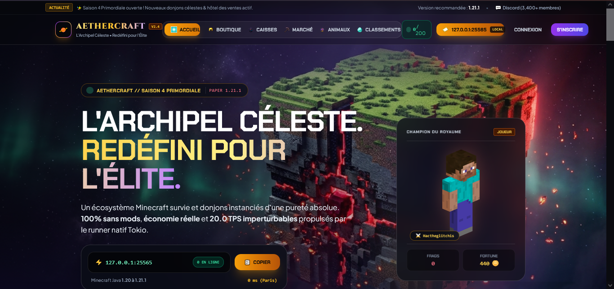
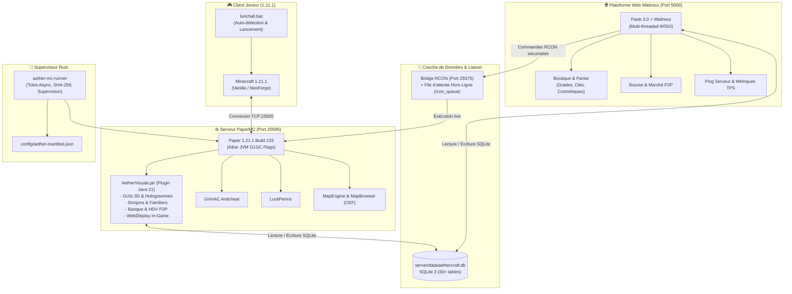

# 🌌 AetherCraft — Plateforme MMORPG Minecraft Paper & Web Control Plane

<p align="center">
  
</p>

> 🛡️ **Développé et audité avec [AetherScope SAST 150 CWE MCP](https://github.com/maxxwwim/AetherScope-SAST-150-CWE-MCP)** — Moteur d'intelligence architecturale, pare-feu IA temps réel (< 50 ms) et gouvernance automatisée 150+ règles CWE / OWASP.

> 🌐 **Démo en ligne (GitHub Pages) :** [https://maxxwwim.github.io/TEST-Minecraft-Server-Paper-Aethercraft-DB-Web-Server-Personnal-Mode-/](https://maxxwwim.github.io/TEST-Minecraft-Server-Paper-Aethercraft-DB-Web-Server-Personnal-Mode-/)


[](https://papermc.io/)
[](https://adoptium.net/)
[](https://www.python.org/)
[](https://flask.palletsprojects.com/)
[](https://www.sqlite.org/)
[](https://www.rust-lang.org/)
[](LICENSE)
[](https://maxxwwim.github.io/TEST-Minecraft-Server-Paper-Aethercraft-DB-Web-Server-Personnal-Mode-/)

---

## ⚡ Démarrage Rapide en 2 Clics (Windows)

Pour installer et lancer l'ensemble de l'infrastructure sur un nouveau PC :

```
1. Double-cliquez sur : install.bat   (Configure l'environnement Java 21, Python, la DB et compile le plugin)
2. Double-cliquez sur : lunchall.bat  (Démarre la Boutique Web, le serveur PaperMC 1.21.1 et le Client)
```

Dès le lancement, votre navigateur et vos services sont opérationnels :
- **Boutique & Dashboard Web :** [http://127.0.0.1:5000](http://127.0.0.1:5000)
- **Connexion Minecraft :** `127.0.0.1:25565` (ou `localhost`)
- **Console RCON Sécurisée :** `127.0.0.1:25575`

---

## 🐧 Démarrage sur Linux / Serveur Dédié

```bash
# 1. Rendre exécutable et installer les dépendances (Java 21, Python venv, DB, Paper)
chmod +x *.sh server/*.sh
./install.sh

# 2. Démarrer le serveur Paper et le Web en arrière-plan (session tmux/screen gérée)
./lunchall.sh

# 3. Arrêter proprement les services
./stop-all.sh
```

---

## 📋 Prérequis Système

| Composant | Version Requise | Rôle | Lien / Commande |
| :--- | :--- | :--- | :--- |
| **Java (JDK/JRE)** | **Java 21 LTS** | Serveur PaperMC & Plugin Java | [Eclipse Temurin JDK 21](https://adoptium.net/temurin/releases/?version=21) |
| **Python** | **3.10 à 3.14** | Plateforme Web, API REST, RCON, Bourse | [python.org](https://www.python.org/downloads/) *(cocher "Add to PATH")* |
| **Client Minecraft** | **1.21.1** | Connexion jeu (Vanilla ou NeoForge/Fabric) | Launcher officiel, Modrinth, Prism, CurseForge |
| **Rust / Cargo** *(Optionnel)* | **1.75+ (2021 edition)** | Compilation du superviseur `aether-mc-runner` | [rustup.rs](https://rustup.rs/) |

---

## 🏗️ Architecture Globale du Projet



---

## 📁 Structure du Codebase

```
aethercraft/
├── Capture.PNG                    # Aperçu de l'architecture et du dashboard
├── README.md                      # Ce guide officiel complet
├── install.bat                    # Installateur 1-clic Windows (Java 21, Python, SQLite, Plugin)
├── lunchall.bat                   # Lanceur tout-en-un Windows (Web + Serveur Paper + Client)
├── install.sh                     # Installateur automatique Linux
├── lunchall.sh                    # Lanceur global Linux (Tmux / Screen / Nohup)
├── stop-all.sh                    # Arrêt propre de tous les services sous Linux
│
├── config/                        # Manifestes de déploiement
│   └── aether-manifest.json       # Spécification déclarative PaperMC, plugins et JVM
│
├── runner/                        # Superviseur Rust haute-performance (aether-mc-runner)
│   ├── Cargo.toml                 # Dépendances (tokio, clap, reqwest, sha2, serde)
│   ├── README.md                  # Documentation technique du runner Rust
│   └── src/
│       ├── main.rs                # CLI (install, run, install-and-run, doctor)
│       ├── installer.rs           # Téléchargements par chunks avec validation SHA-256
│       ├── manifest.rs            # Schéma déclaratif du manifest JSON
│       └── runner.rs              # Processus Java supervisé et logs colorisés
│
├── server/                        # Racine du serveur Minecraft PaperMC 1.21.1
│   ├── server.jar                 # Exécutable Paper 1.21.1
│   ├── server.properties          # Port 25565, RCON 25575, MOTD, difficulté Hard
│   ├── eula.txt                   # EULA acceptée (eula=true)
│   ├── run-server.bat             # Lanceur serveur avec flags Aikar JVM
│   ├── run-server.sh              # Lanceur Linux serveur
│   ├── data/
│   │   └── aethercraft.db         # Base relationnelle unifiée SQLite (partagée Jeu & Web)
│   ├── plugins/                   # Plugins Bukkit/Paper actifs
│   │   ├── AetherVisuals.jar      # Moteur MMORPG in-house (compilé depuis plugins_src)
│   │   ├── GrimAC.jar             # Anticheat basé sur la physique des paquets
│   │   ├── LuckPerms-Bukkit.jar   # Gestion des permissions et grades
│   │   ├── Chunky-Bukkit.jar      # Pré-génération asynchrone des mondes
│   │   ├── MapEngine-all.jar      # Framework virtuel de rendu de cartes
│   │   ├── MapBrowser-all.jar     # Navigateur Chromium in-game sur cartes
│   │   └── packetevents-spigot.jar# Bibliothèque réseau de bas niveau
│   └── plugins_src/               # Code source Java du plugin AetherVisuals
│       ├── build_plugin.py        # Compilateur ECJ Java 21 automatisé
│       └── AetherVisuals/
│           ├── src/               # 54 classes Java 21 et plugin.yml
│           └── bin/               # Bytecode compilé (.class)
│
├── web/                           # Plateforme Web Joueur & Contrôle (Flask + Waitress)
│   ├── app.py                     # Contrôleur web principal et API REST
│   ├── requirements.txt           # Dépendances Python (flask, waitress, requests, etc.)
│   ├── services/
│   │   ├── database.py            # Connecteur SQLite & 30 tables relationnelles
│   │   ├── rcon_service.py        # Client RCON Source natif avec file d'attente hors-ligne
│   │   ├── store_service.py       # Logique boutique, panier et paiement double devise (€ / Points)
│   │   ├── player_service.py      # Profils joueurs, skins mc-heads et classements
│   │   ├── server_status_service.py # Ping socket TCP 25565 et métriques de charge
│   │   ├── block_renderer.py      # Moteur de rendu 3D isométrique des minerais et blocs
│   │   ├── pet_3d_renderer.py     # Moteur de rendu voxel 3D des familiers
│   │   └── security_middleware.py # Sécurité, limitation de débit et sanitisation
│   ├── templates/                 # Vues Jinja2 avec composants dynamiques HTMX
│   │   ├── index.html             # Accueil & Jauge de l'Arbre Primordial en temps réel
│   │   ├── shop.html              # Boutique officielle avec panier interactif
│   │   ├── market.html            # Hôtel des Ventes P2P & Bourse des minerais
│   │   ├── crates.html            # Roulette animée des coffres célestes
│   │   ├── companions.html        # Galerie 3D des 5 familiers mystiques
│   │   └── webdisplay.html        # Écran optimisé pour le rendu MapBrowser in-game
│   └── static/                    # Feuilles de style, textures et assets 3D générés
│
└── tests/                         # Suite de tests d'intégration et de sécurité
    ├── conftest.py
    ├── test_m1_data_layer.py      # Validation de la couche SQLite unifiée
    ├── test_web_socket_security.py# Tests de pénétration Web et RCON
    └── test_dofus_bank_features.py# Tests du système bancaire et de l'économie
```

---

## 🔍 Analyse Détaillée des 4 Piliers

### 1. Le Client Minecraft & Le Superviseur Rust

#### A. Lanceur Tout-en-Un (`lunchall.bat`)
Le script `lunchall.bat` centralise l'expérience complète :
- **Vérification automatique :** S'assure que `server.jar` est prêt (déclenche `install.bat` si nécessaire).
- **Synchronisation automatique :** Si un dossier `client-mods/` est présent, les mods (`FancyMenu`, `Konkrete`, `Melody`) et les configurations d'écrans MMORPG sont synchronisés vers `%APPDATA%\.minecraft`.
- **Détection intelligente du launcher :**
  1. Launcher officiel Xbox / Windows Store (`C:\XboxGames\Minecraft Launcher\Content\Minecraft.exe`)
  2. Launcher officiel LocalAppData (`%LOCALAPPDATA%\Programs\Minecraft Launcher\MinecraftLauncher.exe`)
  3. Launcher officiel Program Files x86
  4. Application Modrinth (`%LOCALAPPDATA%\Programs\Modrinth App\Modrinth App.exe`)
  5. Protocole système Windows URI (`start minecraft:`)
- **Directives de jeu :** Connexion directe recommandée sur `127.0.0.1:25565` avec le profil **1.21.1**.

#### B. Superviseur Rust (`runner/`)
Le module Rust `aether-mc-runner` offre une alternative de supervision industrielle :
- **Validation cryptographique :** Télécharge les composants spécifiés dans `config/aether-manifest.json` avec contrôle d'empreinte SHA-256.
- **Isolation d'exécution :** Protection contre les injections de commandes (`CVE-RUST-CMD-INJ`).
- **Colorisation des flux :** Intercepte les sorties standard et d'erreur de la JVM pour étiqueter automatiquement les logs (`[MC-READY]`, `[MC-WARN]`, `[MC-ERR]`).
- **Commande Doctor :** Vérifie la présence de Java 21 et la connectivité aux APIs PaperMC Fill v3.

---

### 2. Le Serveur Minecraft Paper 1.21.1

- **Noyau :** PaperMC 1.21.1 (Build 133, protocole 767).
- **Optimisation JVM Aikar :** Exécution sous garbage collector G1GC avec drapeaux haute performance :
  ```bash
  java -Xms2G -Xmx3G -XX:+UseG1GC -XX:+ParallelRefProcEnabled -XX:MaxGCPauseMillis=200 \
       -XX:+UnlockExperimentalVMOptions -XX:+DisableExplicitGC -XX:+AlwaysPreTouch \
       -XX:G1NewSizePercent=30 -XX:G1MaxNewSizePercent=40 -XX:G1ReservePercent=20 \
       -XX:SurvivorRatio=32 -XX:InitiatingHeapOccupancyPercent=15 -jar server.jar --nogui
  ```
- **Sécurité Réseau & RCON :**
  - RCON natif activé sur le port `25575`.
  - Mot de passe d'administration synchronisé avec le service web.
  - Anticheat **GrimAC** pour la détection en temps réel des triches de déplacement et de combat sans faux positifs.
- **Génération & Mondes :**
  - `world` : Survie principale avec spawn céleste suspendu à `Y=120`.
  - `world_nether` & `world_the_end` : Dimensions vanille optimisées.
  - `world_oneblock` : Monde instancié pour le mode de jeu OneBlock infini.

---

### 3. La Plateforme Web Joueur & Boutique (Port 5000)

Propulsée par **Python 3 / Flask** et le serveur WSGI de production **Waitress** :
- **Architecture SQLite Unifiée :**
  Accède directement à `server/data/aethercraft.db`. Aucune désynchronisation entre le web et le jeu :
  - **30 tables relationnelles :** `players`, `ranks`, `store_orders`, `rcon_queue`, `market_listings`, `bank_accounts`, `achievements`, `community_goals`, etc.
  - **Gestion propre des connexions :** Classe `ManagedConnection` assurant la fermeture immédiate de chaque connexion SQLite pour éviter les verrous (`database is locked`).
- **Bridge RCON Résilient avec File d'Attente :**
  Lorsqu'un achat est validé sur la boutique web, une commande RCON est envoyée au serveur. Si le serveur Minecraft est éteint ou en redémarrage, la commande est automatiquement placée dans la table `rcon_queue` et sera exécutée dès la reprise de connectivité.
- **Boutique Multi-Devises :**
  Gestion des achats en Euros réels (€) et en Points Célestes acquis en jeu.
- **Moteur de Rendu 3D Intégré :**
  Les scripts `block_renderer.py` et `pet_3d_renderer.py` génèrent des aperçus 3D isométriques haute fidélité des minerais et des familiers, affichés dynamiquement sur le web et in-game.

---

### 4. Le Plugin Minecraft Exclusif (`AetherVisuals`)

Écrit en **Java 21**, structuré en 54 classes modulaires et compilable à la volée via ECJ (`server/plugins_src/build_plugin.py`).

#### Liste Exhaustive des Commandes In-Game

| Commande | Alias | Description & Rôle | Permission |
| :--- | :--- | :--- | :--- |
| `/menu` | `/aether`, `/profil`, `/hub` | Ouvre l'interface centrale Voxel Primordiale AetherCraft (Orbes de Vitalité, quêtes, succès) | Joueur |
| `/shop` | `/boutique`, `/magasin` | Boutique Céleste officielle in-game synchronisée en direct avec SQLite | Joueur |
| `/marche` | `/ah`, `/market`, `/bourse` | Hôtel des Ventes P2P entre joueurs et Bourse des Minerais en temps réel | Joueur |
| `/banque` | `/bank`, `/vault` | Banque privée (coffre-fort personnel 36 slots & livret d'épargne rémunéré) | Joueur |
| `/rtp` | `/wild`, `/aleatoire` | Téléportation aléatoire sécurisée sur terre ferme (vérification asynchrone des chunks) | Joueur |
| `/spawn` | `/agora` | Téléportation instantanée à l'Agora Céleste du Spawn (`Y=120`) | Joueur |
| `/survie` | `/survival`, `/regensurvie` | Téléportation vers votre base de survie ou l'esplanade du portail | Joueur |
| `/back` | `/retour` | Retourne à votre position précédente ou au lieu de votre dernière mort | Joueur |
| `/top` | `/baltop`, `/classement` | Affiche les classements officiels (fortune, temps de jeu, victoires) | Joueur |
| `/pet` | — | Invocation des 5 familiers célestes (dragon, capybara, renard, chèvre, phénix) | Joueur |
| `/cosmetics`| — | Contrôle des ailes quantiques animées et cosmétiques de particules | Joueur |
| `/aura` | — | Activation des auras particulaires selon le grade (VIP, Aether, Titan) | Joueur |
| `/quest` | `/quests`, `/quetes` | Consultation et validation des Quêtes Célestes scénarisées | Joueur |
| `/dungeon` | `/dungeons`, `/donjon` | Expéditions et donjons instanciés avec vagues de monstres et boss | Joueur |
| `/achievement`| `/achievements`, `/succes`| Trophées royaux et hauts-faits débloqués | Joueur |
| `/quiz` | `/trivia`, `/aetherquiz` | Mini-jeu de Trivia interactif dans le chat avec récompenses en jetons | Joueur |
| `/phone` | `/smartphone`, `/iphone` | Smartphone virtuel AetherOS affiché sur une carte en main | Joueur |
| `/webdisplay`| `/ecran`, `/webshop` | Déploie un écran UHD interactif face au joueur affichant la Boutique Web | Joueur |
| `/oneblock` | `/ob`, `/island`, `/ile` | Génère ou rejoint votre île OneBlock céleste personnelle | Joueur |
| `/spawnmode`| `/ambiance` | Modifie le mode d'ambiance vivante du Spawn (sanctuary, festival, cyber, aurora) | Joueur |
| `/crate` | — | Gestion et animation d'ouverture des caisses célestes | Admin (`aether.admin`) |
| `/booster` | — | Déclenchement des boosters d'expérience et de minage x2 | Admin (`aether.admin`) |
| `/buildspawn`| — | Régénération et construction procédurale de l'Agora Céleste | Admin (`aether.admin`) |
| `/aethertest`| — | Attribution de tous les objets de test et activation des cosmétiques | Admin (`aether.admin`) |

---

## ⚙️ Les Deux Fichiers Essentiels sous Windows

| Fichier | Rôle Principal |
| :--- | :--- |
| **`install.bat`** | **Installateur automatique 1-clic :** installe Java 21 portable si absent, vérifie Python, installe les dépendances pip, initialise la base SQLite, compile le plugin Java 21 via ECJ et génère les blocs 3D isométriques. |
| **`lunchall.bat`** | **Lanceur unique & tout-en-un :** vérifie l'installation, lance le serveur Web Waitress (port 5000), le serveur Minecraft Paper (port 25565), ouvre le navigateur web et lance automatiquement le client joueur Minecraft. |

---

## 🌐 Configuration Réseau & Ports

| Service | Port par Défaut | Protocole | Configuration |
| :--- | :--- | :--- | :--- |
| **Boutique & Web Dashboard** | `5000` | HTTP / TCP | `web/app.py` |
| **Serveur Minecraft Paper** | `25565` | Minecraft / TCP | `server/server.properties` (`server-port`) |
| **Console RCON Sécurisée** | `25575` | RCON / TCP | `server/server.properties` (`rcon.port`) |
| **AetherScope MCP (Optionnel)** | `3030` | HTTP / TCP | `AETHER_AI_RULES.md` |

---

## 🛠️ Dépannage & FAQ

**Q1 : Les ports 25565 ou 5000 sont déjà occupés.**  
*Solution :* Vérifiez qu'un ancien processus Java ou Python n'est pas resté actif. Dans PowerShell :
```powershell
Stop-Process -Name java,python -Force
```
Sous Linux :
```bash
./stop-all.sh
```

**Q2 : Erreur Java 21 non détecté lors de l'installation.**  
*Solution :* Téléchargez [Adoptium Temurin JDK 21](https://adoptium.net/temurin/releases/?version=21) et assurez-vous de cocher *"Set JAVA_HOME"* et *"Add to PATH"* lors de l'installation.

**Q3 : Comment recompiler manuellement le plugin `AetherVisuals` ?**  
*Solution :* Exécutez simplement :
```bash
python server/plugins_src/build_plugin.py
```
Le fichier `server/plugins/AetherVisuals.jar` sera immédiatement recompilé et prêt.

**Q4 : Comment réinitialiser la base de données à zéro ?**  
*Solution :* Supprimez le fichier `server/data/aethercraft.db`, puis relancez `install.bat` (ou `python web/services/database.py`). Le schéma avec les 30 tables sera recréé avec les valeurs d'origine.

---

## 📜 Licence & Crédits

- Développé et audité avec [AetherScope SAST 150 CWE MCP](https://github.com/maxxwwim/AetherScope-SAST-150-CWE-MCP).
- Distribué sous licence **MIT**.
